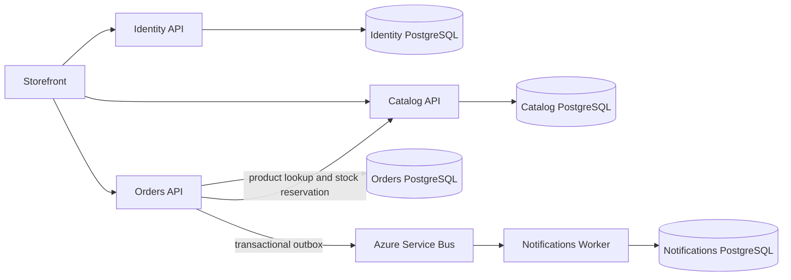

# BPS microservice architecture

Bhagyashree Pattar Store (BPS) is split into independently deployable Identity, Catalog, Orders, and Notifications components. Each component owns its database. Orders orchestrates checkout through a persisted saga; it does not share a transaction with Catalog.



## Service ownership

| Component | Responsibility | Local endpoint/database |
| --- | --- | --- |
| Identity API | Registration, login, password hashing, JWT issuance | API :8082 / `marketly_identity` |
| Catalog API | Product search, prices, inventory, expiring reservations | API :8081 / `marketly_catalog` |
| Orders API | Checkout idempotency, saga orchestration, order history, outbox | API :8080 / `marketly` |
| Notifications Worker | Idempotent event consumption and durable notification work items | background worker / `marketly_notifications` |

No service references another service's EF model or shares its database. Orders stores customer and product IDs as external IDs. Its own order-to-order-item relationship is a local foreign key. Identity and Orders share only JWT validation configuration. Catalog's reservation routes are internal contracts authenticated with `X-Service-Key`; production should use managed identity or service-to-service OAuth and private networking.

## HTTP endpoint style and service entry points

The HTTP services use ASP.NET Core MVC controllers. Orders routes are in `Marketly.Api/Controllers`, Catalog routes are in `Marketly.Catalog.Api/Controllers`, and Identity routes are in `Marketly.Identity.Api/Controllers`. Each API's `Program.cs` is its own startup entry point: it registers that service's dependencies, middleware, controllers, and database setup. The Notifications worker also has a `Program.cs`, but it is a background process with no HTTP controllers. These are separate executable services, not duplicate entry points for one application.

## Checkout and reliability

1. The client sends `POST /api/checkout` with a bearer token and an `Idempotency-Key` header. Orders stores the customer/key pair under a unique database constraint and hashes the canonical request. Retrying the same request returns the same outcome; using the key with a different request returns a conflict.
2. Orders creates a durable saga row with a stable saga/order ID. A PostgreSQL advisory lock prevents multiple API replicas and the recovery worker from processing the same saga simultaneously.
3. Orders fetches current product prices, freezes the quote in the saga, and asks Catalog to reserve each item. Reservation IDs are deterministic for the saga and product, so retries do not decrement inventory twice.
4. Catalog stores each reservation with a 15-minute expiry. Its background worker returns stock for abandoned active reservations. Orders can atomically commit the complete reservation set; if checkout fails, compensation releases the reservations.
5. Orders creates and persists a payment intent with an expiry. The local adapter returns a simulated INR intent; the Razorpay adapter creates a server-side Razorpay order in paise. Only after payment confirmation does Orders validate the Razorpay HMAC signature and independently fetch the payment, checking captured status, provider order ID, exact amount, and currency. It then commits inventory and writes the paid order, completed saga, and `OrderPlaced` outbox message in one Orders database transaction.
6. The outbox worker claims pending rows with PostgreSQL `FOR UPDATE SKIP LOCKED`, sends them to Azure Service Bus, retries failures with exponential backoff, and records delivery. If Service Bus accepts an event but the worker crashes before marking the row processed, it may be delivered again.
7. Notifications consumes the event and writes a unique inbox marker plus a durable notification request in one transaction before acknowledging the message. A redelivery is recognized and acknowledged without creating duplicate work. Provider-specific email/SMS delivery remains a separate adapter.

This is at-least-once message delivery with idempotent processing, not exactly-once transport. Retain idempotency records for the full client retry/replay window; if old saga payloads are archived, keep a compact customer/key/hash tombstone so a delayed duplicate cannot start another order. Razorpay test integration verifies captured payment and issues a refund if saga compensation is needed after capture. Configure automatic capture in the Razorpay dashboard and add webhook-based reconciliation for ambiguous browser/network failures before live launch. Monitor old nonterminal sagas, outbox backlog, retries, notification backlog, and Service Bus dead letters.

## SOLID and persistence patterns

- **Single Responsibility:** Identity handles accounts, Catalog handles products and stock, and Orders handles checkout and order policy.
- **Dependency Inversion:** Orders use cases depend on ports for repositories, payment, events, and Catalog; Infrastructure implements persistence and HTTP adapters.
- **Interface Segregation:** Application ports expose focused business actions.
- **Repository and Unit of Work:** Orders repositories do not call `SaveChanges`; checkout commits the local order/saga/outbox transaction through the unit of work. Catalog uses a repository and conditional/transactional EF updates.
- **Outbox and Inbox:** The outbox makes event creation atomic with order persistence. The consumer inbox makes its local effect atomic with deduplication.
- **Dapper:** EF Core currently serves OLTP reads and writes. Dapper is not included because there is no measured query bottleneck or complex report that justifies a second persistence stack. It can be added behind a read repository for a measured reporting path without replacing EF Core's transaction handling.

Avoid shared databases, shared EF entity assemblies, and cross-service joins. Use stable IDs and versioned API/event contracts.

## Run locally

Requirements: Docker Desktop with Compose, or .NET 10 SDK plus four PostgreSQL databases.

```bash
docker compose up --build
```

Storefront: `http://localhost:3000`. Its Nginx routes `/api/catalog`, `/api/identity`, and `/api/orders` to the APIs. Swagger: Orders `:8080/swagger`, Catalog `:8081/swagger`, Identity `:8082/swagger`. PostgreSQL host ports are Orders 5432, Catalog 5433, Identity 5434; Notifications is internal to Compose. Local Compose applies service migrations and seeds Catalog demo products. Service Bus is optional locally; without it, outbox messages stay persisted for later delivery.

Set `POSTGRES_PASSWORD`, `JWT_SECRET`, `SERVICE_API_KEY`, and optionally `SERVICE_BUS_CONNECTION_STRING` in `.env` for integration development. Compose defaults to `PAYMENT_PROVIDER=Simulated`; to use Razorpay test checkout set `PAYMENT_PROVIDER=Razorpay`, `RAZORPAY_KEY_ID`, and `RAZORPAY_KEY_SECRET`. Keep the key secret in the Orders API environment only. Never put it in storefront JavaScript. The JWT secret must match between Identity and Orders; the service key must match between Orders and Catalog. Azure can use `ServiceBus__FullyQualifiedNamespace` with each container app's managed identity instead of a Service Bus connection string.

Checkout requires a delivery address and a fresh idempotency key for each distinct user action. It initially returns `202` with a payment intent. Confirm Razorpay payments at `POST /api/checkout/{sagaId}/payment`; the local-only simulation route is `POST /api/checkout/{sagaId}/simulate-payment` and is disabled outside Development.

```bash
curl -X POST http://localhost:8080/api/checkout \
  -H 'Authorization: Bearer YOUR_TOKEN' \
  -H 'Idempotency-Key: 2c0e8880-0f51-4adf-9e45-b25464e9acb4' \
  -H 'Content-Type: application/json' \
  -d '{"items":[{"productId":"PRODUCT_GUID","quantity":1}],"deliveryAddress":{"name":"Sam Example","addressLine1":"1 Main Street","addressLine2":"","city":"Bengaluru","region":"Karnataka","postalCode":"560001","countryCode":"IN"}}'
```

## Database changes and production deployment

Each service has its own EF migration history. Production should apply reviewed migrations as release jobs with schema-scoped credentials; do not enable automatic migration during app startup. Compose reuses the Orders `marketly_data` volume to preserve the earlier demo's order history.

Deploy Orders, Catalog, Identity, and Notifications Worker as separate Azure Container Apps (or equivalent). Provision one Azure Database for PostgreSQL database per component. Keep Catalog's internal inventory routes private. Use Key Vault references for database credentials and JWT signing material; for Service Bus, set `ServiceBus__FullyQualifiedNamespace` and grant the Orders managed identity send rights and the Notifications managed identity receive rights. Require TLS and restrict network access. Configure Service Bus dead-letter monitoring and retention for processed outbox, inbox, and saga rows. Broker duplicate detection can help, but Inbox deduplication remains necessary.

The storefront reads products and inventory from Catalog, signs in through Identity, and sends authenticated checkout through Orders using same-origin Nginx API routes. Its cart is browser-local until checkout. Before live launch, add Razorpay webhook reconciliation, a real notification delivery provider, operational dashboards/tracing, and readiness checks; use test keys for local checkout.
